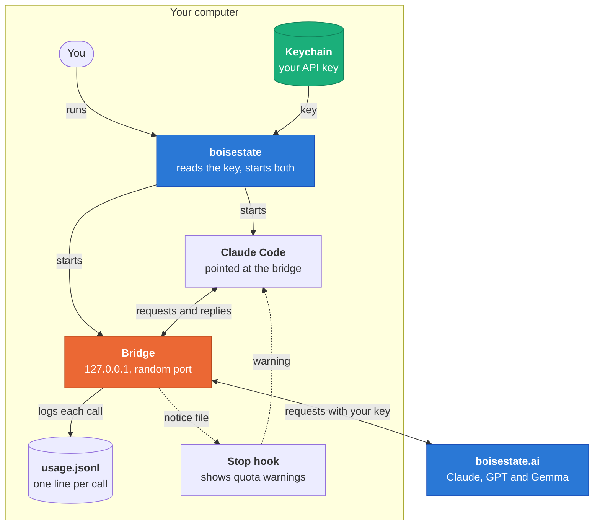
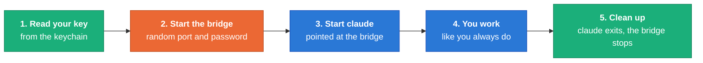
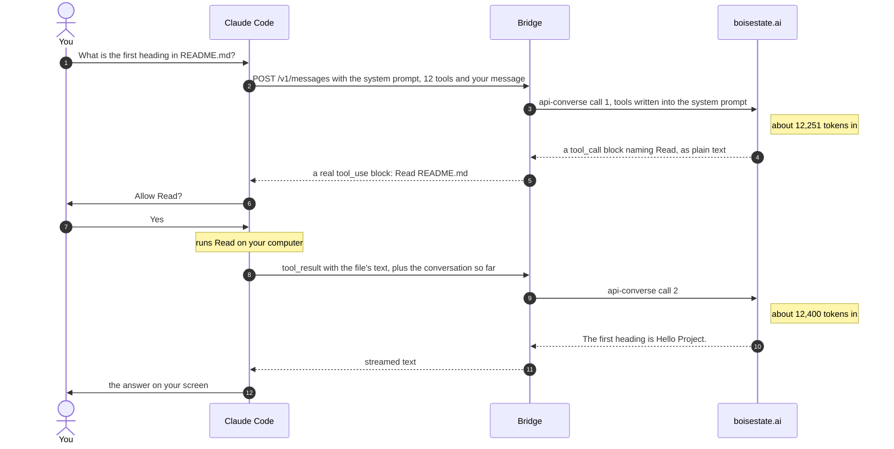
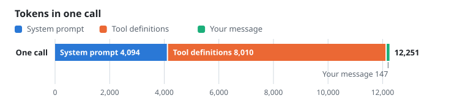
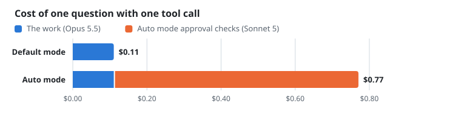
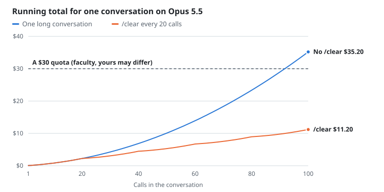
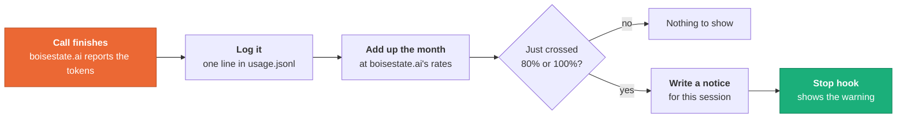
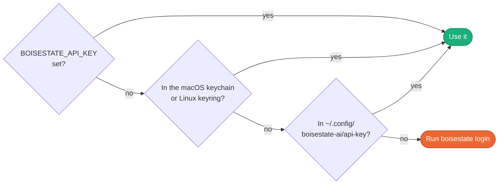

<p align="center"></p>

<h1 align="center">How it works</h1>

<p align="center">
  <a href="quickstart.md">Quickstart</a> · <b>How it works</b> · <a href="../README.md">README</a>
</p>

Claude Code only knows how to talk to Anthropic's API. boisestate.ai has its
own API that works differently. The plugin runs a small bridge on your computer
that translates between the two, so Claude Code never knows the difference.

- [The big picture](#the-big-picture)
- [What `boisestate` does](#what-boisestate-does)
- [One turn, step by step](#one-turn-step-by-step)
- [Tools as text](#tools-as-text)
- [Where your quota goes](#where-your-quota-goes)
- [Quota warnings](#quota-warnings)
- [Keeping your key safe](#keeping-your-key-safe)
- [Limits](#limits)
- [Files it keeps](#files-it-keeps)
- [Using the bridge alone](#using-the-bridge-alone)

## The big picture

There are three programs involved. `boisestate` is the command you type. It
starts the **bridge**, a tiny web server that only your own computer can reach,
and then starts the normal **Claude Code** app pointed at it. Every request
Claude Code makes goes to the bridge, and the bridge sends it on to
boisestate.ai with your API key.



Everything in the "Your computer" box runs on your computer. Only the bridge
talks to boisestate.ai, and only the bridge ever sees your API key.

## What `boisestate` does

A Claude Code plugin can add commands and hooks, but it can **not** change
where Claude Code sends its requests. That is read once when Claude Code
starts. So `boisestate` wraps `claude`, and it does these five things every
time you run it:



Here is exactly what `claude` gets in step 3:

| Setting | Value | Why |
|---|---|---|
| `ANTHROPIC_BASE_URL` | `http://127.0.0.1:<port>` | Sends every request to the bridge |
| `ANTHROPIC_AUTH_TOKEN` | a new random value each run | Only this Claude Code can use this bridge |
| `ANTHROPIC_API_KEY` | removed | So a real Anthropic key can never leak through |
| `BOISESTATE_API_KEY` | removed | Claude Code never sees your boisestate.ai key |
| `--model` | `claude-opus-5-5` | The most capable model on boisestate.ai |
| `--strict-mcp-config` | on | No MCP servers, since every tool costs tokens on every call |
| `--permission-mode` | `default` | Auto mode is switched off, see [below](#why-auto-mode-is-off) |

> [!NOTE]
> You can still pick your own model and mode, for example
> `boisestate --model sonnet` or `boisestate --permission-mode plan`. The only
> thing it overrides is auto mode.

## One turn, step by step

Let's follow one question that needs a tool. We ask Claude what the first
heading in `README.md` is. The model can't read files itself, so it asks
Claude Code to run the `Read` tool, and then answers. That one question is
**two** calls to boisestate.ai.



The token counts are from a real Claude Code session against a stand-in for
boisestate.ai, estimated at 4 characters per token. The bridge logs both calls
to `usage.jsonl`.

## Tools as text

This is the trickiest part of the bridge. Anthropic's API has tool calling
built in: Claude Code sends a list of tools, and the model can answer with a
structured `tool_use` block. boisestate.ai's API does not have tools at all. It
takes text and gives back text.

So the bridge writes the tools into the system prompt as plain text, along with
instructions for how to call one. Here is the same request on both sides of the
bridge.

<table>
<tr><th>Claude Code sends the bridge</th><th>The bridge sends boisestate.ai</th></tr>
<tr>
<td valign="top">

```text
POST /v1/messages
{
  "model": "claude-opus-5-5",
  "system": "You are Claude Code...",
  "tools": [
    { "name": "Read",
      "input_schema": { ... } },
    ... 11 more tools
  ],
  "messages": [
    { "role": "user",
      "content": "What is the first
                  heading in README.md?" }
  ],
  "stream": true
}
```

</td>
<td valign="top">

```text
POST /api/chat/api-converse
X-API-Key: your key
{
  "model_id":
    "global.anthropic.claude-opus-5-5",
  "system_prompt": "You are Claude Code...

# Calling tools
To call a tool, write a block
exactly like this ...

# Tools
## Read ...",
  "messages": [ same messages ],
  "stream": true
}
```

</td>
</tr>
</table>

The model answers with a tagged block of JSON. The bridge finds it, checks that
it is a tool Claude Code actually offered, and turns it into a real `tool_use`
block. If the model writes text before the block, that text goes to you as
normal.

<table>
<tr><th>boisestate.ai replies with text</th><th>Claude Code gets a real tool call</th></tr>
<tr>
<td valign="top">

```text
<tool_call>
{"name": "Read",
 "input": {"file_path":
   "/home/you/proj/README.md"}}
</tool_call>
```

</td>
<td valign="top">

```json
{
  "type": "tool_use",
  "id": "toolu_6f1c...",
  "name": "Read",
  "input": {"file_path":
    "/home/you/proj/README.md"}
}
```

</td>
</tr>
</table>

On the next call, the tool's result goes back the same way, as a
`<tool_result name="Read">` block of text. A live test of 40 different requests
through boisestate.ai, with Claude Code's full prompt and tools, parsed every
single reply.

> [!WARNING]
> The catch is that the tool list is text, so it is sent with **every** call.
> With native tools that is also true, but here it is about two thirds of every
> request. That is why MCP servers are off: each one adds more tools to every
> single call.

## Where your quota goes

boisestate.ai charges by the token, a chunk of text about 4 characters long.
You pay for tokens in (everything sent to the model) and tokens out (what it
writes back). Opus 5.5 costs $4 per million tokens in and $20 per million out,
and Sonnet 5 costs half that.

| Sent with every call | One small call on Opus 5.5 | Small calls in a $30 month |
|:---:|:---:|:---:|
| **12,251**<br>tokens, before your first word | **$0.055**<br>12,251 in and about 300 out | **about 540**<br>and real calls are bigger |

### What one call carries

Most of every request is Claude Code's own instructions and its tool list. Your
message is the sliver on the end.

<picture>
  <source media="(prefers-color-scheme: dark)" srcset="assets/chart-request-dark.svg">
  
</picture>

| Part | Tokens |
|---|---:|
| System prompt | 4,094 |
| Tool definitions | 8,010 |
| Your message | 147 |
| **Total** | **12,251** |

### Why auto mode is off

Auto mode lets Claude Code approve its own tool calls. To do that safely it
asks a second model to check each step. Through the bridge that was about six
extra 55,000 token calls to Sonnet per turn, which used up a month's quota in
under an hour.

<picture>
  <source media="(prefers-color-scheme: dark)" srcset="assets/chart-auto-dark.svg">
  
</picture>

| Mode | The work (Opus 5.5) | Approval checks (Sonnet 5) | Total |
|---|---:|---:|---:|
| Default mode | $0.11 | $0.00 | $0.11 |
| Auto mode | $0.11 | $0.66 | $0.77 |

### Long conversations add up

Every call sends the **whole** conversation again, so each one costs a little
more than the last. Running `/clear` when you switch tasks starts the count
over. The chart assumes each call adds 1,500 tokens to the conversation (about
one small file read) and writes 300 tokens back.

<picture>
  <source media="(prefers-color-scheme: dark)" srcset="assets/chart-session-dark.svg">
  
</picture>

<details>
<summary>Show the numbers</summary>

| Calls | One long conversation | `/clear` every 20 calls |
|---:|---:|---:|
| 10 | $0.82 | $0.82 |
| 20 | $2.24 | $2.24 |
| 30 | $4.26 | $3.06 |
| 40 | $6.88 | $4.48 |
| 50 | $10.10 | $5.30 |
| 60 | $13.92 | $6.72 |
| 70 | $18.34 | $7.54 |
| 80 | $23.36 | $8.96 |
| 90 | $28.98 | $9.78 |
| 100 | $35.20 | $11.20 |

</details>

The $30 line is a faculty account's quota. Yours may be different, and
`boisestate usage` shows the real limit once boisestate.ai has reported it.
`npm run charts` redraws these charts if the numbers change.

## Quota warnings

boisestate.ai's usage page needs a browser, so the bridge keeps its own count.
After every call it writes one line to a log with boisestate.ai's own token
counts, then adds up the month. If you have just crossed 80% or 100%, you see a
warning when Claude finishes its turn.



Every session on your computer logs to the same file, so two terminals running
at once still add up right. Each warning shows once, the first time you cross
it. When boisestate.ai refuses a call because the quota is gone, it says
exactly what you have spent and what the limit is, and the bridge saves that
too, so the next estimate starts from the real number.

```console
$ boisestate usage
2026-10: $6.00 of $30.00 (20%), logged calls only

model                                               calls          input       output      cost
global.anthropic.claude-opus-5-5                       84      1,000,000      100,000     $6.00
...
```

## Keeping your key safe

Your API key is basically your credit card for boisestate.ai, so it lives in
the safest place your computer has and goes to as few programs as possible.
Here is where `boisestate` looks for it:



- **Claude never sees it.** The key goes to the bridge and nowhere else. It is
  removed from the environment Claude Code runs in, so a tool can't print it by
  accident.
- **Only your computer.** The bridge listens on 127.0.0.1, which other
  computers can't reach, and wants a random password that changes every run.
- **Never on the command line.** `boisestate login` hands the key to the
  keychain on standard input, so it never shows up in your shell history or the
  process list.

## Limits

boisestate.ai's API is simpler than Anthropic's, so a few things work
differently.

| Thing | What happens |
|---|---|
| Images | Dropped. boisestate.ai's API only takes text, so pasting a screenshot does nothing. |
| Long answers | boisestate.ai stops any single request after about 60 seconds. |
| Context gauge | An estimate at 4 characters per token, since boisestate.ai has no way to count tokens ahead of time. |
| Temperature and similar settings | Not sent. boisestate.ai rejects them. |
| MCP servers | Off, since their tools would ride along in every call. |

### Models

Your key works with these seven models. The usage report can only price the two
it knows the rates for, and it marks the rest as "no rate".

| Model | Short name | $ per million in | $ per million out |
|---|---|---:|---:|
| `global.anthropic.claude-opus-5-5` | `opus` | 4 | 20 |
| `global.anthropic.claude-sonnet-5` | `sonnet` | 2 | 10 |
| `global.anthropic.claude-haiku-4-5-20251001-v1:0` | `haiku` | ? | ? |
| `global.openai.gpt-6-sol` | `gpt-6-sol` | ? | ? |
| `global.openai.gpt-5.6-terra` | `gpt-5.6-terra` | ? | ? |
| `global.openai.gpt-6-luna` | `gpt-6-luna` | ? | ? |
| `google.gemma-4-31b` | `gemma-4-31b` | ? | ? |

## Files it keeps

| Path | What is in it |
|---|---|
| `~/.local/bin/boisestate` | The command. It finds the installed plugin each time it runs. |
| `~/.local/state/boisestate-ai/usage.jsonl` | One line per call: time, model, tokens in and out |
| `~/.local/state/boisestate-ai/bridge.log` | Errors from the bridge, if any |
| `~/.local/state/boisestate-ai/notices-<pid>.jsonl` | Quota warnings for one session, removed when it ends |
| `~/.config/boisestate-ai/api-key` | Your key, only on Linux without `secret-tool` |

The folders follow `XDG_STATE_HOME` and `XDG_CONFIG_HOME` if you set them.
`BOISESTATE_USAGE_LOG` moves the usage log.

## Using the bridge alone

The bridge also speaks the OpenAI chat API, so other tools and your own scripts
can use boisestate.ai through it too. `boisestate bridge` runs it in the
foreground until you press Ctrl+C. Set `BRIDGE_PORT` to pick the port and
`BRIDGE_TOKEN` to require a password.

```console
$ BRIDGE_PORT=8787 boisestate bridge
{"ready":true,"port":8787}
```

Then from another terminal:

```sh
curl -s http://127.0.0.1:8787/v1/chat/completions \
  -H 'content-type: application/json' \
  -d '{"model": "sonnet", "messages": [{"role": "user", "content": "Say hi"}]}'
```

| Route | API |
|---|---|
| `POST /v1/messages` | Anthropic Messages, what Claude Code uses |
| `POST /v1/messages/count_tokens` | Anthropic token count (an estimate) |
| `POST /v1/chat/completions` | OpenAI chat completions |
| `GET /v1/models` | The seven models |
